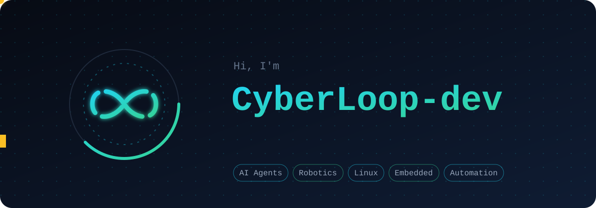
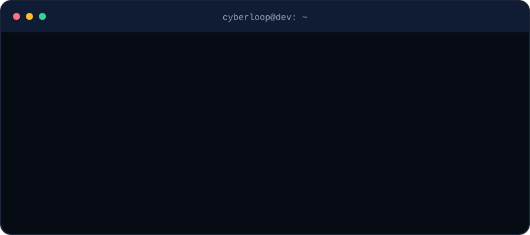

 

 

## 👋 Hello, world

I'm **CyberLoop-dev**, an Iranian developer who likes building things that *move*: scripts that automate, tools that help other developers, agents that act, and robots that do something in the real world.

My GitHub bio says it best: **"Building robots & Cyber coding. Code that moves things."**

## 🧭 About me

| | |
| :-: | :-- |
| 🇮🇷 | **Iranian**, based in **Iran** |
| 💻 | Software development, automation, web development and APIs |
| 🤖 | Artificial intelligence, AI agents and robotics |
| 🐧 | Linux and operating systems |
| 🔌 | Embedded systems and developer tools |

## 🖥️ Workspace

  

## 🧰 Languages I write

  

**Python** · **JavaScript** · **TypeScript** · **HTML5** · **CSS3** · **Kotlin**

## 🧱 Stack and environment

A map of where my languages meet my interests. Only the languages above are things I write today; the rest of the table is direction, not a skills claim.

| Area | Focus | Languages |
| :-- | :-- | :-- |
| 🎨 **Frontend** | Fast, dependency-light web tools and interfaces |  |
| ⚙️ **Backend and APIs** | APIs and automation |  |
| 🧠 **AI and agents** | AI agents that plan and act |  |
| 🔌 **Robotics and embedded** | Software that talks to hardware | *exploring, see below* |
| 🐧 **Operating systems** | Linux and how systems work | *interest* |
| 🛠️ **Developer tools** | CLI tools, dashboards and utilities, all hosted on  |  |

## 🌱 Exploring and learning

Languages I'm curious about and poking at. This is exploration, not a list of things I claim to have mastered.

  

## 🎯 Areas of interest

| | | |
| :-- | :-- | :-- |
| 🧠 Artificial intelligence | 🕹️ AI agents | 🤖 Robotics |
| 🐧 Linux and operating systems | 💻 Software development | ⚡ Automation |
| 🌐 Web development | 🔗 APIs | 🔌 Embedded systems |
| 🛠️ Developer tools | | |

### 🤖 AI and robotics

I'm drawn to the point where software stops being a window on a screen and starts doing things: an agent that can plan a task, a script that reacts to the world, a board that moves a motor. That's the direction everything else here is pointing.

## 🚀 Featured projects

Everything below is real and public.

### 🧰 Tools and automation

| Project | What it does |
| :-- | :-- |
| 🧹 [**tidyup**](https://github.com/CyberLoop-dev/tidyup) | Sorts a messy Downloads folder into tidy folders, with a safe preview, no overwrites and a one-command undo. Pure Python. |
| 🔒 [**face-autolock**](https://github.com/CyberLoop-dev/face-autolock) | Locks your laptop when you walk away, but not when you merely look away. Webcam, Python and OpenCV, fully offline. |
| 🛰️ [**sysdeck**](https://github.com/CyberLoop-dev/sysdeck) | A live terminal dashboard: CPU cores, RAM, disks, network sparklines and top processes. One command, zero config. |

### 🎨 Web tools (HTML, CSS and JavaScript, zero dependencies)

| Project | What it does |
| :-- | :-- |
| 🔍 [**jsonlens**](https://github.com/CyberLoop-dev/jsonlens) | Format, minify, validate and explore JSON as a searchable tree. |
| 🎨 [**qrstudio**](https://github.com/CyberLoop-dev/qrstudio) | Customizable QR codes for links, Wi-Fi and contacts, with PNG and SVG export. |
| 🔐 [**passcheck**](https://github.com/CyberLoop-dev/passcheck) | A privacy-first password strength checker that never leaves your browser. |
| 🌈 [**gradlab**](https://github.com/CyberLoop-dev/gradlab) | Build CSS gradients visually and copy the code. |
| 🌫️ [**shadowlab**](https://github.com/CyberLoop-dev/shadowlab) | Design layered CSS box-shadows with a live preview. |
| 🪄 [**palettepop**](https://github.com/CyberLoop-dev/palettepop) | One color in, a whole palette out, with WCAG contrast checks. |

## 📊 GitHub stats

These cards are generated live by third-party services. If one fails to load, my numbers are always at [github.com/CyberLoop-dev](https://github.com/CyberLoop-dev).

## 🧠 Developer philosophy

- 🛡️ **Safe by default.** Preview before changing anything, never overwrite, always allow undo.
- 🔒 **Private by design.** If it can run locally and offline, it should.
- ⚡ **Zero config.** One command, or one file to open. Dependencies have to earn their place.
- ✨ **Small and sharp.** Do one thing well, then make it pleasant to use.

## 📬 Contact

The best way to reach me right now is through GitHub: open an issue on any repository or follow along at **[@CyberLoop-dev](https://github.com/CyberLoop-dev)**.

<!-- Add your own links here when you're ready, for example:
[Email](mailto:you@example.com) · [Telegram](https://t.me/yourname) · [LinkedIn](https://linkedin.com/in/yourname)
-->

 

